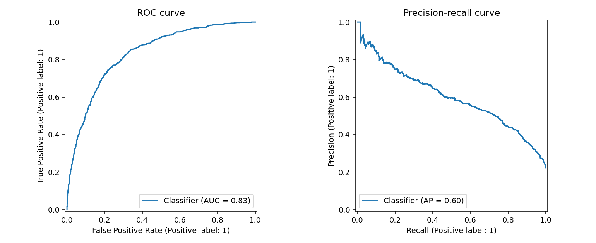
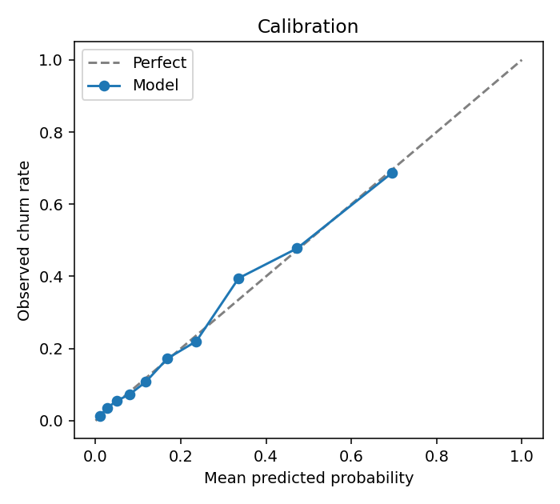
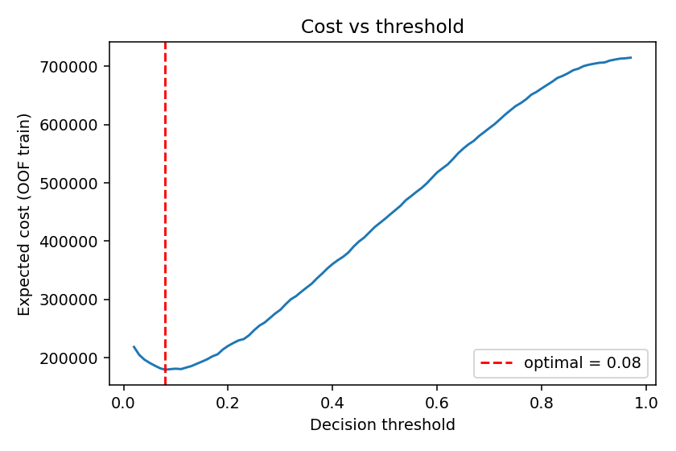
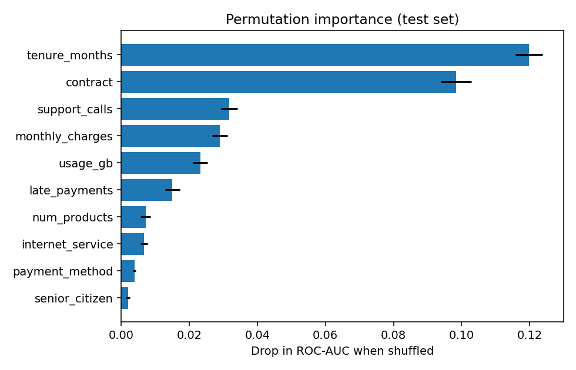

# Churn-ML: Cost-Aware Customer Churn Prediction

[](https://github.com/<your-username>/churn-ml/actions)


An end-to-end machine-learning system that doesn't just predict *who* will churn, it decides
*whom to act on* by optimizing the decision threshold against **business cost** rather than accuracy.
It covers the full lifecycle: data generation, leakage-free training, model selection, probability
calibration, evaluation, artifact versioning, a REST API, Docker and CI.

## Highlights

- **Leak-free methodology**: the decision threshold is tuned on *out-of-fold training predictions*; the test set is touched exactly once.
- **Model selection** via stratified K-fold CV across Logistic Regression, Random Forest and Gradient Boosting.
- **Probability calibration** (Platt / isotonic) so outputs can be read as real churn probabilities.
- **Cost-sensitive decisioning**: the threshold minimizes `FN·cost_fn + FP·cost_fp` (configurable in YAML).
- **Training/serving parity**: feature engineering and preprocessing live *inside* the sklearn pipeline, so there is no skew.
- **Production serving**: FastAPI with strict Pydantic validation, single + batch endpoints, health & model-info.
- **Reproducible & traceable**: seeded, config-driven, artifacts include data hash, library versions and CV results.
- **Engineering hygiene**: tests, linting, GitHub Actions CI matrix, non-root Docker image with healthcheck.

## Results

Held-out test set (4,000 customers, ~22% churn), default config:

| Metric | Value |
|---|---|
| ROC-AUC | **0.833** |
| PR-AUC | **0.602** |
| Recall @ cost-optimal threshold (0.08) | 0.936 |
| Precision @ cost-optimal threshold | 0.323 |
| Expected cost vs. best naive baseline | **-25%** |

Cross-validated ROC-AUC: Logistic Regression 0.835 · Gradient Boosting 0.835 · Random Forest 0.825
(the pipeline picks the winner automatically).

| ROC / PR | Calibration |
|---|---|
|  |  |

| Cost vs. threshold | Permutation importance |
|---|---|
|  |  |

> The dataset is **synthetic** (generated with realistic non-linear effects and missing values), so
> absolute numbers say nothing about real-world performance. The methodology is what transfers.
> To use real data, drop a CSV with the same columns at `data/raw/churn.csv`.

## Architecture

```
configs/config.yaml ──► train.py ──► artifacts/{model.joblib, metadata.json, metrics.json, reports/}
                           │                                   │
 data.py ─► features.py ─► models.py ─► evaluate.py            ▼
 (generate)  (in-pipeline)  (3 candidates) (metrics, cost)   predict.py ──► api.py (FastAPI) / cli.py
```

```
src/churn_ml/
  config.py    YAML loader
  data.py      synthetic generator, schema constants, data hashing
  features.py  feature engineering + preprocessing pipeline
  models.py    candidate model zoo
  train.py     CV selection, calibration, threshold, evaluation, persistence
  evaluate.py  metrics, cost optimization, diagnostic plots
  predict.py   inference wrapper (risk tiers)
  api.py       FastAPI service
  cli.py       generate-data | train | predict
tests/         unit + integration + API tests
```

## Quickstart

```bash
git clone https://github.com/<your-username>/churn-ml && cd churn-ml
python -m venv .venv && source .venv/bin/activate
make install          # deps + editable install
make train            # trains, evaluates, writes artifacts/ (~1 min)
make test
make serve            # http://localhost:8000/docs
```

Score customers from the CLI:

```bash
python -m churn_ml.cli predict examples/sample_customers.json
```

Call the API:

```bash
curl -X POST localhost:8000/predict -H 'Content-Type: application/json' -d '{
  "tenure_months": 3, "monthly_charges": 105.0, "num_products": 1, "support_calls": 5,
  "late_payments": 3, "senior_citizen": 0, "usage_gb": 10.0,
  "contract": "Month-to-month", "internet_service": "Fiber", "payment_method": "Electronic check"}'
# {"churn_probability":0.9928,"will_churn":true,"risk_tier":"high"}
```

Docker (trains at build time):

```bash
make docker
```

## Configuration

Everything tunable lives in `configs/config.yaml`: sample size, CV folds, per-model hyperparameters,
calibration method, and the **business costs** that drive the decision threshold. Change
`cost_false_negative` / `cost_false_positive` and the operating point moves accordingly.

## Design decisions

- **Why optimize cost, not F1?** Missing a churner and bothering a loyal customer have very different prices. At a 10:1 cost ratio the theoretically optimal threshold is ~1/11 ≈ 0.09, and the learned one (0.08) matches.
- **Why calibrate?** Ranking metrics ignore probability quality, but cost-based thresholds and risk tiers depend on it.
- **Why a single sklearn Pipeline?** Engineered features and imputation ship inside the artifact, eliminating training/serving skew.

## Roadmap

- Drift monitoring (PSI / KS) on incoming traffic
- SHAP-based per-prediction explanations
- Experiment tracking with MLflow, hyperparameter search with Optuna
- Uplift modelling (who is *persuadable*, not just who will churn)

## License

MIT
